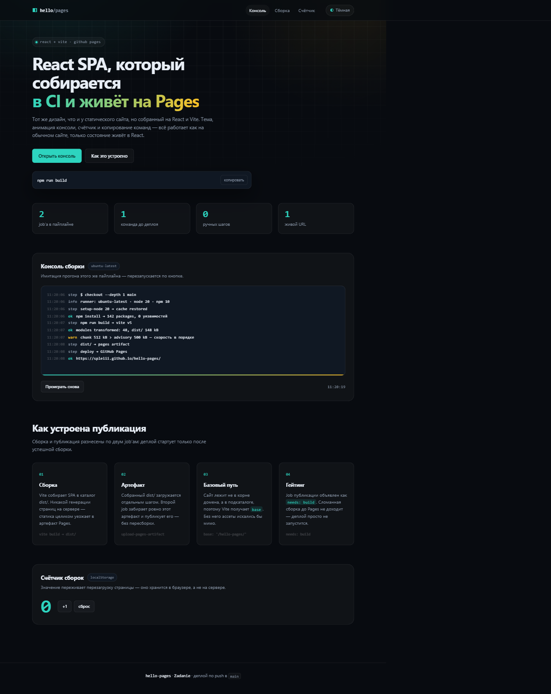

# hello-pages

React-приложение на Vite, которое собирается в CI и публикуется на
**GitHub Pages**. Дизайн — общий с заданием [`hello-static`](../hello-static):
та же тёмная и светлая темы, та же консоль сборки, тот же счётчик. Разница
одна: здесь всё состояние живёт в React.



---

## Что на странице

| Блок | Содержимое |
|---|---|
| Шапка | логотип, навигация по разделам, переключатель темы |
| Герой | заголовок, описание, кнопки и команда `npm run build` с копированием |
| Числа | четыре метрики публикации |
| Консоль | анимация прогона этого же пайплайна: логи, прогресс-бар, часы, кнопка перезапуска |
| Сборка | четыре карточки: как устроена публикация |
| Счётчик | значение переживает перезагрузку страницы |

---

## Что делает пайплайн

| Job | Что происходит |
|---|---|
| `build` | `npm install` → `npm run build` → `dist/` уезжает в артефакт Pages |
| `deploy` | публикация `dist/` на GitHub Pages |

Сборка и публикация разнесены по двум job'ам: деплой объявлен как
`needs: build`, поэтому сломанная сборка на сайт не попадёт — деплой просто
не запустится.

---

## Путь публикации

Сайт лежит не в корне домена, а по адресу `/hello-pages/`, поэтому в
`vite.config.js` задан базовый путь:

```js
export default defineConfig({
  plugins: [react()],
  base: '/hello-pages/',
})
```

Без этой строки ассеты искались бы в корне домена и сайт открывался бы
пустым.

---

## Живой сайт

<https://spleiii.github.io/hello-pages/>

---

## Структура

```
hello-pages/
├── index.html            # разметка и запуск темы до первой отрисовки
├── package.json          # зависимости и скрипты
├── package-lock.json     # зафиксированные версии — сборка воспроизводима
├── vite.config.js        # конфигурация сборщика
├── public/
│   └── favicon.svg       # иконка вкладки
└── src/
    ├── main.jsx          # точка монтирования
    ├── App.jsx           # разметка страницы
    ├── data.js           # весь контент: логи, метрики, карточки
    ├── hooks.js          # тема, часы, счётчик, консоль, скролл
    └── index.css         # дизайн-система (общая с hello-static)
```

---

## Как это устроено

Весь контент вынесен в `data.js` — правки вёрстки не трогают его. Всё
поведение — семь хуков в `hooks.js`:

| Хук | Зачем |
|---|---|
| `useTheme` | тёмная и светлая темы, выбор сохраняется в `localStorage` |
| `useClock` | часы в консоли, обновление раз в секунду |
| `useCounter` | счётчик с сохранением в `localStorage` |
| `useConsole` | анимация логов: по одному таймеру на строку + прогресс-бар |
| `useReveal` | появление блоков при прокрутке через `IntersectionObserver` |
| `useActiveSection` | подсветка активного раздела в навигации |
| `useCopy` | копирование в буфер с запасным вариантом через `execCommand` |

Тема ставится **до** первой отрисовки — инлайновый скрипт в `index.html`
читает `localStorage` и выставляет `data-theme`, чтобы страница не мигала
светлым фоном на тёмной теме.

Анимация появления блоков включается только если скрипты работают: класс
`.js` ставит тот же инлайновый скрипт, а правило `.js .reveal` скрывает
контент. Без JavaScript страница остаётся читаемой.

---

## Запуск

```bash
npm install

# разработка с горячей перезагрузкой
npm run dev

# продакшн-сборка
npm run build
npm run preview
```

---

[← к списку заданий](https://github.com/SpleIII/Zadanie)
